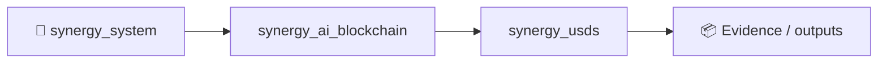

# USDS: экономическая модель Base fork

Эксперимент моделирует цикл **MINT USDS → SELL в CPMM → восстановление цены до
$1**. Код и fork-тест находятся в [`valut_v4`](valut_v4/BASE_FORK_README_RU.md).

## Короткий ответ: сколько чистого выхлопа на $1

Для базового сценария (`q = 1%`, 100 циклов, `value added = 3 × sale proceeds`,
газ `$0.01` за цикл):

| Показатель | На всю систему | На $1 стартового USDC |
|---|---:|---:|
| Стартовый реальный капитал | $2.00 | $1.0000 |
| Накопленная выручка от продажи USDS | $1.681960 | $0.8410 |
| Требуемый PP top-up | $3.384097 | $1.6920 |
| Предполагаемый внешний value added (`3x`) | $5.045881 | $2.5229 |
| **Распределяемый остаток после восстановления PP и газа** | **$0.661783** | **$0.3309** |

Таким образом, ответ модели — **$0.3309 распределяемого остатка на каждый $1
первоначально вложенного USDC за 100 циклов**. Но это не доходность самого
«печатного станка»: число получается только при заданной извне гипотезе, что
productive engine реализует value added в размере `3 × sale proceeds` в каждом
цикле. Mint и продажа сами по себе не создают долларовой прибыли.

Если внешний двигатель доходности отсутствует (`value added = 0`), чистый
экономический результат механизма равен **минус газ**, а PP buffer постепенно
исчерпывается. Sale proceeds — это перенос USDC из пула в productive principal,
а не новая стоимость.

## Откуда берётся знаменатель $2

В начале нужны два реальных вклада USDC:

1. `$1.00` — USDC-резерв CPMM;
2. `$1.00` — предфинансированный PP buffer.

Начальный `1 USDS` является эмиссией протокола и не считается внешним
долларовым капиталом. Внешний стартовый капитал системы поэтому равен ровно
`$2`, а не стоимости напечатанной стороны пары. Модель использует:

```text
initial_external_capital = initial_pool_usdc + initial_pp_buffer_usdc
                         = $1.00 + $1.00
                         = $2.00
```

## Экономика одного цикла (`q = 1%`)

При начальном пуле `1 USDS / 1 USDC`:

| Шаг | Результат |
|---|---:|
| Напечатано USDS | 0.010000 USDS |
| Получено от продажи | $0.009872 USDC |
| Цена после продажи | $0.980335 |
| USDC top-up для возврата к $1 | $0.019862 |
| Гипотетический value added `3x` | $0.029615 |
| Остаток после top-up и газа | **−$0.000247** |
| Остаток / стартовый капитал системы | **−$0.000123 на $1** |

Для малых `q` top-up составляет примерно `2 × sale proceeds`. Причина: выручка
остаётся в productive principal, а восстановить нужно одновременно USDC,
вынутые из пула при продаже, и покрытие добавленных в резерв USDS.

## Формулы

Для резервов `x` USDS и `y` USDC, доли эмиссии `q`, swap fee `f = 0.003` и
protocol burn `b = 0.001`:

```text
minted       = x × q
curve_in     = minted × (1 - f)
to_pool      = minted × (1 - b)
sale         = y - (x × y) / (x + curve_in)
x_after      = x + to_pool
y_after      = y - sale
pp_topup     = x_after - y_after              # цель: 1 USDC за 1 USDS
value_added  = multiple × sale                # внешняя гипотеза
surplus      = value_added - pp_topup - gas
```

Главное тождество: `value_added` не следует из CPMM-формул. Пока отдельная
стратегия не доказала эту доходность реальными сделками, корректно считать
`$0.3309` **сценарным результатом**, а не гарантированным ROI.

## Чувствительность: 100 циклов при `3x`

Все значения ниже — распределяемый остаток на `$1` стартового внешнего капитала
после top-up и газа:

| Эмиссия `q` за цикл | Остаток на $1 |
|---:|---:|
| 0.10% | **−$0.4478** |
| 0.50% | **−$0.1816** |
| 1.00% | **$0.3309** |
| 2.00% | **$2.4812** |
| 5.00% | **$58.0237** |

При капитале всего `$2` сто циклов по `$0.01` дают `$1` совокупного газа.
Поэтому малые `q` убыточны даже при допущении `3x`; это важное отличие от
прежнего миллионного масштаба. Фактическая комиссия Base должна измеряться по
receipt, а не приниматься равной `$0.01` без проверки.

Большие числа не являются бесплатной прибылью: при `q = 5%` модель одновременно
**предполагает** внешний value added `$185.1929` на каждый стартовый `$1`.
Экспоненциальный рост резервов делает такую гипотезу всё более требовательной к
реальной производительности и ликвидности стратегии.

## Проверка

Без RPC:

```bash
cd valut_v4
python3 -m unittest -v test_model.py
python3 base_v5_mint_sell_pp.py
```

На локальном fork Base инструкции приведены в
[`BASE_FORK_README_RU.md`](valut_v4/BASE_FORK_README_RU.md). Fork доказывает
исполнение и бухгалтерские инварианты, но синтетический депозит `3x` не
доказывает достижимость доходности.

## Base mainnet: минимальный эксперимент

Mainnet-версия имеет двухэтапную передачу owner, pause, защиту от повторного
входа, проверку точного поступления USDC и аварийный вывод всего USDC только в
paused-состоянии. Аварийный вывод необратимо закрывает внутренний учёт.

Кошелёк создаётся локальным скриптом; `.private/` исключён из Git. Потеря файла
`mainnet-deployer.key` означает потерю управления, поэтому до пополнения следует
сделать офлайн-копию. Репозиторий и CI нельзя считать секретным хранилищем.

```bash
cd valut_v4
python3 scripts/generate_wallet.py
# сохранить офлайн .private/mainnet-deployer.key
BASE_RPC_URL=<RPC> scripts/deploy_mainnet.sh
```

Deploy-скрипт отказывается работать не на chain ID `8453`, проверяет bytecode и
`decimals()` native USDC, требует минимум `2 USDC`, выдаёт approve ровно на
`2 USDC`, развёртывает контракт и вызывает `seed(1 USDS, 1 USDC, 1 USDC)`.

Для кошелька нужны **2 native USDC в Base** и **ETH в Base на газ**. Третий
доллар разумно целиком держать в ETH: неиспользованный остаток остаётся на EOA.
Это deployment-ready исследовательский контракт, но не аудит и не обещание
доходности; `productiveUSDC` по-прежнему является учётной корзиной, а не
интеграцией с реальной доходной стратегией.


<!-- SYNERGY-FEDERATION-PASSPORT:START -->
---

## 🧭 SYNERGY federation passport

**Домен:** 💵 Monetary / stable-asset R&D  
**Архитектурный родитель:** [`synergy_ai_blockchain`](https://github.com/Shtenco/synergy_ai_blockchain)  
**Архитектурный корень:** [`synergy_system`](https://github.com/Shtenco/synergy_system)



Архитектурная принадлежность не заменяет доказанную интеграцию. Runtime-связь должна подтверждаться контрактами, manifests, deployment-конфигурацией или тестами.

### Федерационный принцип

Каждый репозиторий отвечает только за свой тип истины и не должен незаметно присваивать полномочия соседнего домена.

### Навигация

- [📚 Атлас 75 репозиториев](https://github.com/Shtenco/synergy_system/blob/main/docs/SYNERGY_REPOSITORY_ATLAS.md)
- [🧾 Registry](https://github.com/Shtenco/synergy_system/blob/main/registry/SYNERGY_REPOSITORIES.json)
- [🧭 Architecture root](https://github.com/Shtenco/synergy_system)

### Evidence rule

Любое сильное утверждение должно указывать на воспроизводимый тест, benchmark, ledger/evidence artifact или формально проверяемый контракт.

<!-- SYNERGY-FEDERATION-PASSPORT:END -->